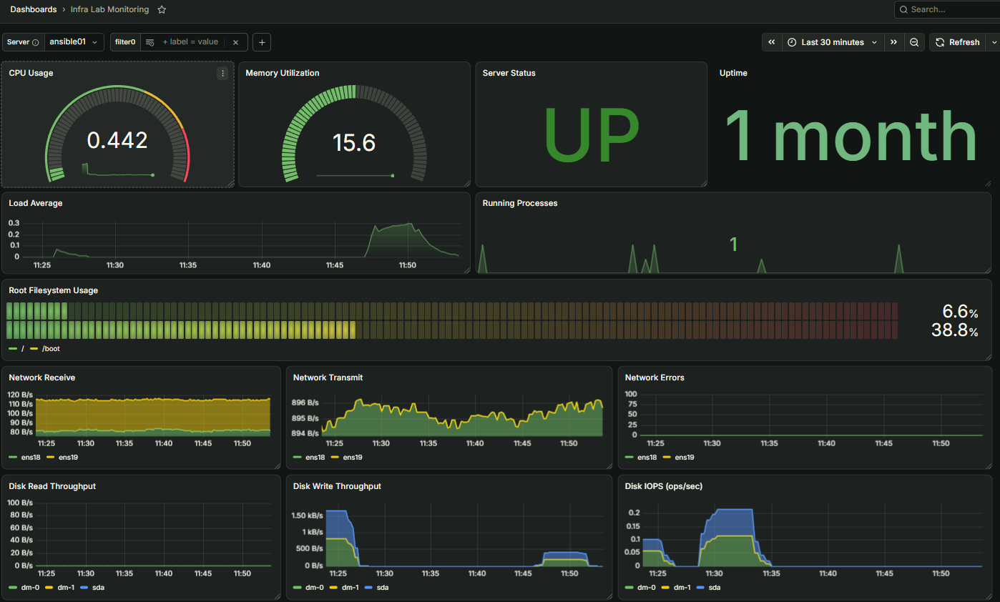

# Centralized Linux Infrastructure Monitoring Platform
A practical, end-to-end implementation guide for building a centralized infrastructure monitoring platform using **Prometheus**, **Node Exporter**, and **Grafana**. This repository contains the architecture pattern, setup configurations, core PromQL metrics queries, and alert rules evaluated from a lab environment.
## 📊 Architecture Overview
The platform isolates metric collection, time-series storage, data visualization, and notification routing:
*   **Node Exporter (Port 9100):** Installed on target Linux hosts to expose hardware and OS metrics.*   **Prometheus (Port 9090):** Central monitoring server that scrapes exporter targets and evaluates alerting logic.*   **Grafana (Port 3000):** Dashboards for metric visualization and unified alert notification management.


Linux Target Host(s)
└── Node Exporter (TCP :9100)
▲
│ Scrape (Pull Model)
│
Central Monitoring Server
├── Prometheus (TCP :9090) ── Time-Series DB / PromQL Engine
└── Grafana (TCP :3000) ── Visualization / Notification Routing


---

## 🛠️ Step 1: Target Node Configuration (Node Exporter)

Run these steps on every Linux host you intend to monitor.

### 1.1 Create System Service Account
```bash
sudo useradd --system --no-create-home --shell /sbin/nologin node_exporter
```

### 1.2 Binary Installation
Download the latest binary release matching your CPU architecture from the official Prometheus releases.
```bash
# Extract and move the binary to system bin path
sudo install -o root -g root -m 0755 node_exporter /usr/local/bin/node_exporter

# Verify installation
/usr/local/bin/node_exporter --version
```

### 1.3 Configure systemd Unit
Create the service descriptor file at `/etc/systemd/system/node_exporter.service`:
```ini
[Unit]
Description=Prometheus Node Exporter
Wants=network-online.target
After=network-online.target

[Service]
User=node_exporter
Group=node_exporter
Type=simple
ExecStart=/usr/local/bin/node_exporter
Restart=on-failure

[Install]
WantedBy=multi-user.target
```

### 1.4 Enable and Start Exporter
```bash
sudo systemctl daemon-reload
sudo systemctl enable --now node_exporter
```

---

## ⚙️ Step 2: Central Prometheus Configuration

### 2.1 Set Up Prometheus Environment
```bash
sudo useradd --system --no-create-home --shell /sbin/nologin prometheus
sudo mkdir -p /etc/prometheus /var/lib/prometheus
sudo chown -R prometheus:prometheus /etc/prometheus /var/lib/prometheus
```

### 2.2 Configure Scrape Targets (`prometheus.yml`)
Populate `/etc/prometheus/prometheus.yml` with global parameters and static targets. Use the `server` label to clean up your Grafana variable views later.

```yaml
global:
  scrape_interval: 15s
  evaluation_interval: 15s

scrape_configs:
  - job_name: "prometheus"
    static_configs:
      - targets: ["localhost:9090"]
        labels:
          app: "prometheus"

  - job_name: "linuxlab"
    static_configs:
      - targets: ["192.0.2.11:9100"]
        labels:
          server: "linux01"
      - targets: ["192.0.2.12:9100"]
        labels:
          server: "linux02"
```
*(Note: Replace `192.0.2.x` placeholder IPs with your actual node addresses.)*

### 2.3 Validate & Launch
```bash
# Validate syntax using promtool
sudo /usr/local/bin/promtool check config /etc/prometheus/prometheus.yml

# Start the pipeline
sudo systemctl daemon-reload
sudo systemctl enable --now prometheus
```

---

## 📈 Step 3: Grafana & Dynamic Server Selection

### 3.1 Setup Multi-Tenant Variables
To avoid hardcoding IP addresses in panel filters, configure a dynamic multi-value template variable within your Grafana Dashboard settings:

*   **Name:** `server`
*   **Type:** `Query`
*   **Data Source:** `Prometheus`
*   **Query Type:** `Label values`
*   **Metric:** `up`
*   **Label:** `server`
*   **Refinement Filter:** `job="linuxlab"`
*   **Selection Options:** Enable `Multi-value` and `Include All`.

### 3.2 Core Dashboard PromQL Queries
When configuring your dashboard panels, use regex matching `server=~"$server"` to ensure the UI switches dynamically based on your dropdown selection:

#### 🟢 Infrastructure Availability
```promql
up{job="linuxlab", server=~"$server"}
```

#### 🧠 CPU Utilization (%)
```promql
100 * (1 - avg by (instance) (rate(node_cpu_seconds_total{job="linuxlab", server=~"$server", mode="idle"}[5m])))
```

#### 💾 Memory Utilization (%)
```promql
100 * (1 - node_memory_MemAvailable_bytes{job="linuxlab", server=~"$server"} / node_memory_MemTotal_bytes{job="linuxlab", server=~"$server"})
```

#### 💽 Root Filesystem Space Used (%)
```promql
100 * (1 - node_filesystem_avail_bytes{job="linuxlab", server=~"$server", mountpoint="/", fstype!~"tmpfs|overlay|squashfs"} / node_filesystem_size_bytes{job="linuxlab", server=~"$server", mountpoint="/", fstype!~"tmpfs|overlay|squashfs"})
```

---

## 🚨 Step 4: Proactive Alerting Logic

To move past manual screen dashboard monitoring, alerts are managed via Grafana Alertmanager. Configure the following alert definitions:

### 💥 Host Unreachable Alert
Using math evaluation to capture explicitly down hosts rather than a completely blank "No Data" response block:
*   **Expression:** `count(up{job="linuxlab"}) - sum(up{job="linuxlab"})`
*   **Condition Check:** Trigger when value is `> 0`.
*   **Pending Duration (`for`):** `5m` (Filters out momentary networking or target scrape hiccups).

### 🔥 Sustained High CPU Threshold
*   **Expression:** `100 * (1 - avg by (instance) (rate(node_cpu_seconds_total{job="linuxlab", mode="idle"}[5m])))`
*   **Warning Rule:** Trigger over `85%`.
*   **Critical Escalation Rule:** Trigger over `95%` sustained for 5 minutes.

---

## 🔒 Security Best Practices
*   **Network Isolation:** Restrict target node traffic on port `9100` specifically to the incoming Prometheus server IP. Keep port `9090` private.
*   **Credential Masking:** Never hardcode SMTP relay usernames, access keys, or production access tokens into public `.yml` or configuration scripts. Utilize internal secret stores or environment injections.

##   Architecture Overview
### 🖥️ Dashboard Preview

